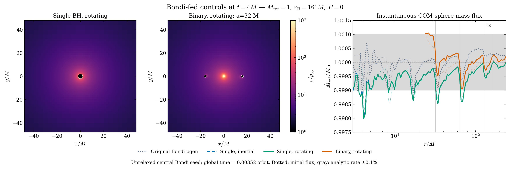

# Bondi control figures

Saved outputs from Aurora debug job 8924219: M_total=1, m1=m2=0.5, a=32 M,
r_B=161.227 M, B=0, gamma=5/3. These are short boundary/mesh tests.

Both configurations start with the centrally concentrated spherical M=1
Michel/Bondi profile. The binary's dense center is unrelaxed initial gas.
The endpoint t=4 M is only 0.00352 orbit (P_binary=1137.378 M). Stored inner
patches have less active evolution. No complete orbit has been relaxed.

The layout is inspired by Figures 1, 2, and 4 of
[Guo et al. (2025)](https://arxiv.org/html/2504.16802v2); all data are our runs.

| Figure | Preview | PDF |
| --- | --- | --- |
| Density and spherical mass flux | [PNG](bondi_paper_comparison.png) | [PDF](bondi_paper_comparison.pdf) |
| Feeding and inner density scales | [PNG](bondi_density_scales.png) | [PDF](bondi_density_scales.pdf) |
| Radial diagnostics | [PNG](bondi_radial_profiles.png) | [PDF](bondi_radial_profiles.pdf) |
| Fine/coarse/fine return with block grids | [PNG](bondi_zoom_sequence.png) | [PDF](bondi_zoom_sequence.pdf) |



Slices interpolate the z cell centers bracketing zero and share a logarithmic
color scale. Black disks mark nominal isolated-hole radii 2m, not measured
binary horizons. Cyan circles show nominal mask radii; only cells with stored
zoom data are held. Montage stages use actual topology because outputs precede
AMR events.

Flux=-r^2 integral(alpha sqrt(det gamma) rho u^r dOmega), evaluated using
saved ADM fields including the rotating shift. The script checks invariance
of the radial velocity projection under the azimuthal frame conversion.
Binary flux is through COM spheres at r>=24 M enclosing both holes, not through
individual horizons. Scalar means omit numerical excision floors.

Local linear AMR interpolation and 64 by 128 angular quadrature give a maximum
initial single-hole flux sampling bias of about 0.19%. Raising quadrature to
96 by 192 changes flux by at most 0.0243% of the analytic rate. Thin dotted
curves show the initial flux on the identical mesh; the residual panel measures
change relative to that sampling. The +/-0.1% gray band is an analytic visual
reference, not demonstrated solver accuracy or a time variability interval.
All profiles are instantaneous.

[Metadata](plot_metadata.json), [CSV](radial_data.csv), [NumPy arrays](radial_data.npz).

Reproduce from retained local outputs, without launching AthenaK:

```sh
python3 scripts/tests/run_bounded.py --seconds 300 --memory-gb 20 \
  --report build-mac-zoom-opt/bondi-plot-resources.json -- \
  python3 scripts/plot_bondi_validation.py \
  --root build-mac-zoom-opt/aurora-results --out docs/bondi_visualizations
```

See the [relaxation cost estimate](../bondi_100_orbit_cost.md) for the clocks.
