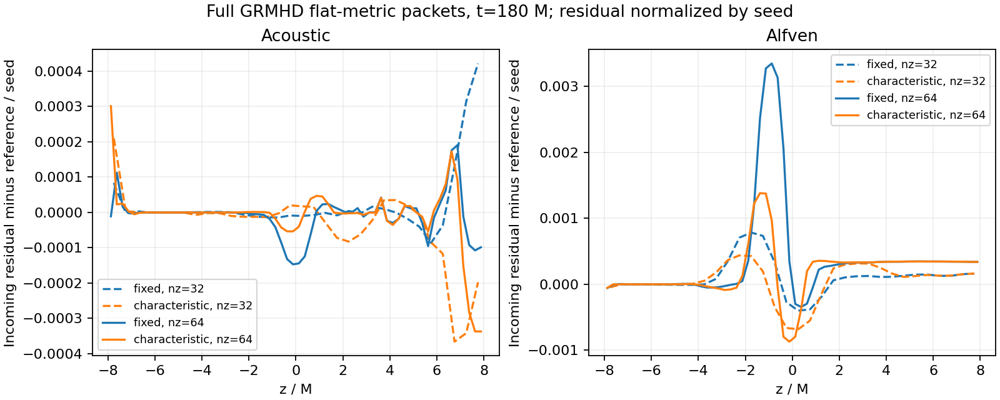

# Full-GRMHD Aurora boundary suite: job8941903

The bounded validation suite **passed**, with a mixed accuracy result. Retain the
fixed-reservoir production default; the characteristic option is experimental.
Job8941903 ran on one capacity node, all 12 GPU tiles, PBS one hour, each solver
invocation retaining `-t 00:55:00` and the 28.4GB aggregate guards. PBS exit0;
all 14 cases reached the requested targets. No new physical zoom evolution was run.
Source, executable and immutable submission hashes were verified. Source is
recorded by commit c3bc0931 and the source manifest in provenance/.

## Audits

- All 168 per-rank resource/memory report pairs passed, with expected one-host
  rank-to-tile affinities and normal solver exits.
- All 28 saved fluid snapshots are finite, with positive density and pressure.
- Maximum scaled magnetic divergence: 2.186e-15; threshold 1e-9. Scaling is
  min(cell widths)*abs(div Btilde)/max(norm Btilde,0.001*ambient Btilde).
- Maximum conservative sum of per-rank peak RSS plus tracked allocations:
  21.6341GB, below the 28.4GB guards and 30GB limit. This deliberately double-counts
  some host allocations, rather than claiming a synchronized unique-memory peak.
- No positivity contractions occur in the last logged characteristic counter
  samples. Counters count pre/post-FOFC face evaluations; periodic samples are
  not necessarily final totals.
- All 12 flat packet cases preserve transverse density uniformity to the asserted
  2e-6 tolerance. See results.json for actual values and all snapshot minima.
- Paired fixed/characteristic real binary ADM/AMR, rotation and smooth-drain smokes
  reach t=0.05 M after 7 cycles. All saved fluid variables are bitwise identical in
  447528 active cells at r<100 M, with identical topology. This verifies short
  integration isolation, not propagation/reflection at the curved outer boundary.

## Packet comparison

All packets use the native nonlinear GRMHD evolution, HLLE and constrained
transport in the flat ADM limit, Omega=0, periodic transverse directions. The
acoustic pulse seeds density/pressure/normal velocity; the Alfven pulse seeds
transverse velocity/B. The dimensionless velocity seed is 0.01, beta-infinity=1,
rB=500 M. Since the characteristic speeds are small compared with c, this seed is
not guaranteed to be an infinitesimal MHD wave; nonlinear compressive content is
present, especially for the Alfven packet.

For each32/64-cell short z-domain [-8,8], a larger [-24,24] domain has the same
cell size and initial pulse centered at z=4 M, width=1 M. At t=180 M the primary outgoing
pulse has crossed the short boundary and has not reached the reference boundary.
Subtract the matched-grid larger-domain incoming-mode residual. This controls
interior evolution/initialization error, but does not give an exact nonlinear
reflection coefficient. The diagnostic is the linear incoming acoustic proxy
(delta rho/rho - vz/cs)/2, or incoming Alfven proxy(vx+Bx/sqrt(rho h+Bz^2))/2.
Velocities use utilde/sqrt(1+utilde^2) in this flat test. Snapshot fields are float32.

Maximum absolute reference-subtracted incoming-mode difference, **percent of
seed amplitude**, is:

| Mode | z cells | Fixed | Characteristic |
|---|---:|---:|---:|
| Acoustic |32|0.04217%|0.03658%|
| Acoustic |64|0.01908%|0.03370%|
| Alfven |32|0.07854%|0.06831%|
| Alfven |64|0.33488%|0.13826%|



Characteristic improves the fine Alfven case by about 59%, but worsens the fine
acoustic case by about 77%. Alfven differences increase on refinement for both
closures; this is not demonstrated spatial convergence or a consistent advantage
for the new boundary. Local seed 0.001 results are separate and must not be used
as a resolution comparison with these seed 0.01 GPU cases.

Fixed and characteristic runs have identical timestep counts: 1440 at nz32 and
2880 at nz64. Measured maximum-rank elapsed-time ratios characteristic/fixed are
2.49/2.30 for acoustic and2.53/2.42 for Alfven. The extra numerical Jacobian and matrix projection substantially increase cost
in these small boundary-heavy tests. This does
not predict overhead in a deep production AMR hierarchy. Characteristic boundary
conditions do not remove the rotating-coordinate CFL restriction.

## Decision and limits

Keep `problem/reservoir_boundary=fixed` as the default. The implemented
characteristic option uses the actual face lapse/shift/spatial metric, preserves
CT normal B, and supplies paired fluid/induction fluxes through the ordinary CT
path before the FOFC predictor and after fallback. It is stable in this bounded
suite but has a first-order interface trace and analytic reservoir ghost closure.
It has not established superior accuracy, nonlinear transparency, or long-term
stability for the rotating binary reservoir. Strong/oblique waves, fast/slow
families, curved-space reflection, long-time corner reentry/exterior memory and
performance optimization remain outstanding. No production switch is justified
by these results.

Raw outputs remain ignored under
build-mac-characteristic/aurora-grmhd/boundary-grmhd-characteristic-20261018-v1.
Small submitted inputs, source/executable checks, all rank reports/logs, PBS
history and output SHA256 manifest are archived in provenance/. Reproduce with:

```sh
python3 scripts/analyze_grmhd_characteristic.py --runs build-mac-characteristic/aurora-grmhd/boundary-grmhd-characteristic-20261018-v1 --out docs/magnetic_bondi_validation/characteristic-boundary/full-grmhd-aurora
python3 scripts/plot_characteristic_packets.py --results docs/magnetic_bondi_validation/characteristic-boundary/full-grmhd-aurora/results.json --out docs/magnetic_bondi_validation/characteristic-boundary/full-grmhd-aurora
```
