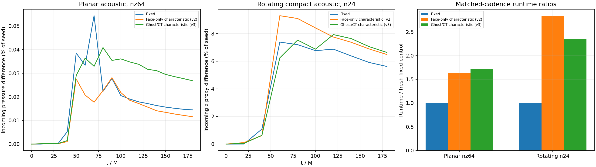

# Ghost reconstruction and native CT: Aurora results, job 8942262

Keep the fixed production boundary. The ghost/CT method passes the flat rotating
controls but provides no consistent acoustic improvement, remains slower, and
does not support the actual refined outer-face topology. **The 33-case suite did
not pass:** 32 cases completed and passed their audits; the final curved-AMR
characteristic case aborted at its explicit support guard before evolution.
No retry or new submission was made.



The acoustic curves are reference-subtracted incoming diagnostics normalized by
the injected seed, not nonlinear reflection coefficients or reflected-energy
fractions. The planar curve uses all seven primitive components in the native
eigenbasis, with coincident families grouped; the rotating curve uses the
incoming z acoustic proxy. Each short/long-domain pair has matched common-grid
spacing, initial data, timesteps and output cadence. Runtime ratios use each
allocation's fresh fixed control; absolute times from different allocations
are not directly compared.

| Fine control, limited quadratic | Fixed | Face-only v2 | Ghost/CT v3 |
|---|---:|---:|---:|
| Planar nz64 final pressure residual (% seed), t180 | 0.01450 | 0.01160 | 0.02687 |
| Planar nz64 peak over saved times (% seed) | 0.05440 | 0.02813 | 0.04091 |
| Planar nz64 runtime / fresh fixed | 1.00 | 1.63 | 1.72 |
| Production-rotation n24 final z proxy (% seed), t180 | 5.621 | 6.487 | 6.636 |
| Production-rotation n24 peak over saved times (% seed) | 7.388 | 9.298 | 7.930 |
| Production-rotation n24 runtime / fresh fixed | 1.00 | 2.84 | 2.35 |

The coherent ghost/CT pipeline reduces the rotating peak relative to face-only
v2, but its final rotating residual is 18.1% larger than fixed and its sampled
peak is 7.3% larger. Planar acoustic peak reduction also does not imply uniformly
smaller late residual: the quadratic final residual is 85.2% larger than fixed.
Order-2 ghost continuation has a smaller planar peak than quadratic at nz64,
but still a larger final residual than fixed. See
[all trace-order histories](acoustic_decision.png). There is no demonstrated
benefit that justifies adopting this boundary in the rotating production study.

The transverse planar Alfvén control is a bounded positive result: at nz32,t180,
the maximum incoming difference / seed decreases from 7.8538e-4 (fixed) to
1.9277e-4 (ghost/CT), a factor 4.07. Runtime increases from 32.23 to 55.95 seconds,
or 1.74x. This is a single planar resolution and does not validate oblique,
curved or corner-crossing Alfvén waves. The high-shift flat tests also pass the
field/resource checks, but their mixed errors do not establish a general gain.

Consistency of ghost states and CT is necessary, but it does not make a local
normal linearized projection transparent to a multidimensional exterior.
Component PPM, limited outgoing continuation and approximate corner extension
remain. These comparisons do not isolate which approximation dominates the
rotating residual. The seven-wave projector is already used; replacing it with
explicit eigenvectors alone would not resolve those discrete or AMR issues.
Coordinate CFL constraints are unchanged.

## Audits and the curved-AMR failure

PBS reports `F`, exit143 after 23m22s. The launcher reports rank6 abort134 and
rank7 termination by signal15. Rank logs identify the cause:

```
Characteristic ghost/CT closure requires unrefined physical faces; interior AMR is allowed
```

This is an unsupported-configuration abort, not a demonstrated evolution
instability or memory-guard stop. Six rank resource reports record SIGABRT with
`stopped=null`; six are missing/incomplete after MPI termination, and all twelve
memory summaries for that failed case are absent. They cannot be counted as
passed audits. Available files, including empty reports, are preserved.

The saved fixed-case initial topology has 1,408 blocks and 80 physical-boundary
blocks: 48 at root level and **32 refined by one level on the x faces**. The local
coarse curved preflight has 176 blocks and 56 physical-boundary blocks, all at
root level. It therefore did not test the unsupported production boundary
topology. This preflight mismatch should have been detected before submission.
[The topology audit](topology_support.json) records both exact meshes.
`scripts/audit_characteristic_mesh_support.py --require-supported` now rejects
the full topology and accepts the local one. Binary levels are relative to root.
Do not remove the runtime guard or infer a successful paired curved comparison.

The other 32 cases pass **384 complete rank resource/memory audits** and 417
saved fluid/divergence snapshots: normal target exits, positive finite fluid
fields, no logged nonfinite repairs or finite-EMF fallbacks, one host with all
12 tile affinities, and unchanged 55-minute solver cutoff. Maximum saved active
scaled divergence is 1.3391e-13. The conservative aggregate sum of rank RSS peaks
and tracked allocation peaks is at most 22.170GB, below the 28.4GB configured
guards and 30GB ceiling. Local all-layer ghost tests separately constrain ghost
divergence; GPU divergence output here covers active cells.

Refined physical faces need consistent coarse ghost restriction/prolongation,
staggered magnetic extension and edge-EMF/reflux ownership, including corners,
before the actual hierarchy can be validated. Strong/oblique curved waves,
long-time exterior reentry and production performance remain unvalidated.
The fixed boundary and physical smooth-excision study are unchanged. No physical
accretion continuation was run or restarted.

## Reproduction and provenance

The executable hash remains
`d48198a64798b54ab7e334b7b14f7f0482f0285fdbec19ae53e34d38c71689c9`.
One capacity node/all12tiles used validated SANE environment/flags, PBS1hour,
per-case900s watchdog and launch cutoff2400s. The failure was the final case,
not a clean launch cutoff. There are no unstarted cases to continue.

Run the partial audit explicitly; the default still requires all33 cases:

```
python3 scripts/analyze_ghost_ct_suite.py --runs [v3local] \
  --previous docs/magnetic_bondi_validation/characteristic-boundary/full-grmhd-aurora/results.json \
  --face-results docs/magnetic_bondi_validation/characteristic-boundary/improved-rotating/aurora \
  --out [this-directory] --allow-unsupported-curved
```

That option requires evidence of the exact refined-face guard failure, audits
the other32 cases, and writes `suite_status.json` as
`incomplete-unsupported-curved`; it does not convert failure to success.
`all_audits.json`, `unsupported_curved.json`, `three_method_comparison.json`,
full-mode/time-series and runtime files retain the numerical findings.
`provenance.tar.gz` holds1,280 non-binary files, including396 rank logs,384 complete
memory reports and392 available resource files (including incomplete failed
reports); `provenance-manifest.json` provides individual hashes. Final qstat is
in `../provenance/qstat-final.txt`. Raw binaries remain ignored under
`build-mac-characteristic/aurora-grmhd/boundary-characteristic-rotating-20261018-v3`.
