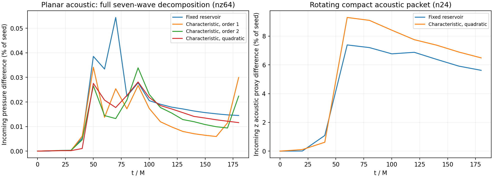
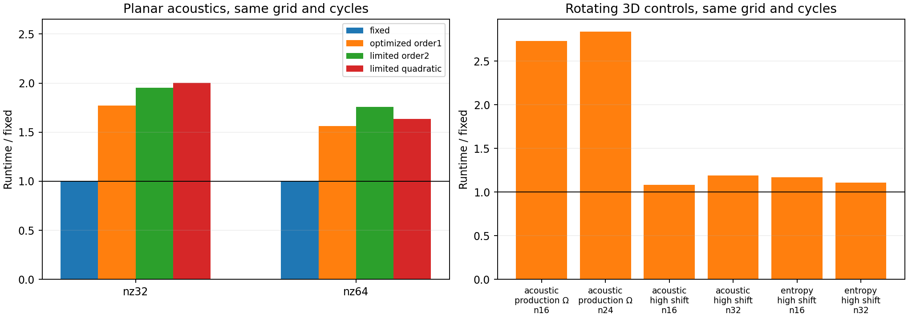

# Completed rotating characteristic-boundary tests

Capacity job **8942061** completed normally (PBS exit0, walltime20m52s).
Thirty cases used one Aurora node/all six GPUs as twelve tiles, the validated
SANE environment, a one-hour allocation, solver 55-minute clean cutoff and
28.4GB aggregate guards. No physical accretion/zoom continuation was run.
The frozen executable SHA256 was
`e90830db0dcd0e3442f5c07dd4b0e0a8d6e25ac4bd6059467e742244d8fb2c81`.

**Recommendation: retain the fixed reservoir as the production default.**
The limited quadratic characteristic trace improves the controlled planar
pressure-wave diagnostic, but makes the production-rate rotating 3D packet
comparison worse and costs about2.84 times as much on that grid.

## Accuracy and runtime

All entries below are maximum spatial differences from a larger-domain control
at the SAME grid spacing, saved time and cycle count, normalized by input
seed 0.01. They are linear incoming diagnostics, **not exact nonlinear reflection
coefficients or reflected-energy fractions**. The 3D proxy is directed along z
and is not an exact decomposition of obliquely propagating waves. Different
geometry rows should not be compared as the same scattering experiment.

| Test at t180 | Fixed reservoir | Quadratic characteristic | Characteristic/fixed runtime |
|---|---:|---:|---:|
| Planar nz64, full-mode incoming pressure, %seed | 0.01450% | 0.01160% | 1.63 |
| Rotating 3D n24, incoming z acoustic proxy, %seed | 5.6209% | 6.4867% | 2.84 |

The largest saved planar nz64 incoming-pressure differences over the encounter
are 0.05440%seed (fixed) and0.02813%seed (quadratic), approximately a factor 1.93
reduction. At nz32 the corresponding peaks are 0.04793% and0.01971%seed.
Thus there is a real benefit to the higher face-trace order in this weak planar
control. The old first-order native implementation and optimized first-order
produce identical final density-proxy profiles; changing trace order changes
the result. Pressure-mode diagnostics avoid the entropy contamination present
in the earlier density-only incoming proxy. The fine-grid density proxy still
slightly favors fixed at the final time; it is not the same observable.

At production Omega=32^(-3/2), the rotating n24 final maximum proxy difference
increases 15.4% with the characteristic treatment; its spatial RMS increases
14.5%. Maximum saved differences during the encounter are 7.3879%seed (fixed)
and 9.2985%seed (characteristic). The same direction holds at n16. These coarse
3D controls do not demonstrate spatial convergence: some errors increase with
resolution. They establish no consistent 3D accuracy benefit.

Fine planar wall times are 65.83s fixed versus 107.52s quadratic; rotating n24
wall times are 26.75s versus 75.91s. Ratios use maximum per-rank elapsed time,
including setup/output, within the same sequential allocation. They are not
production scaling measurements. Historical8941903 saved fewer outputs, so its
runtimes are deliberately excluded from the current runtime ratio plot.
The old first-order points in the profile comparison remain accuracy controls.

## Frame and integration checks

All 30 cases/360 rank resource-memory report pairs pass. All saved fluid fields
are finite, density and pressure positive, each case reaches its requested target,
and the maximum scaled magnetic divergence is 1.3390673e-13. The maximum
conservative sum of rank peak RSS plus tracked allocation is 21.7208GB,
below the 28.4GB guard budget and 30 GB restriction. Every rank report records
its one-host/tile affinity and normal process return. `all_audits.json` retains
the individual measurements; small inputs, receipts, hashes, PBS logs and all
rank reports are archived in `provenance.tar.gz`.

High-shift controls at Omega=sqrt2 (short-box corner coordinate speed16c) reach
t0.4 before possible reentry. At n32 the acoustic maximum proxy differences are
0.00444%seed fixed versus 0.00875%seed characteristic. The entropy density RMS
error against the independent analytic solution is0.3501%seed versus 0.3788%seed;
the n16 analytic entropy comparison instead favors characteristic. Inertial
physical speeds in the entropy cases remain below 8.5e-16, rather than acquiring
the large coordinate shift as gas velocity. These bounded controls show no
instability but do not establish long-time corner or reentry behavior.

Paired actual curved binary ADM/AMR/smooth-drain smokes reach t0.05. All nine
saved fluid fields are bitwise identical at 447,528 common cells inside r100
on identical topology. This is a short integration-isolation check, not curved
wave reflection or long-time validation. All comparisons retain the original
coordinate CFL; characteristic treatment cannot remove that restriction.

## What the full decomposition adds

An explicit seven-wave left/right decomposition is now implemented and tested
offline; see [formulation and limitations](../FULL_DECOMPOSITION.md). It exposes
fast+/-, Alfvén+/-, slow+/- and entropy modes, grouping coincident polarizations.
The normal CT magnetic field remains fixed. Native-symbol checks cover 1,620
states, 870 with degeneracies, including nonorthogonal metrics/lapse/shift and
relativistic flows. For 1,512 unambiguous projections its result agrees with the
existing full matrix-sign projector to 1.29e-8 maximum matrix-component error.
The incoming planar pressure plot uses this full decomposition.

This **is not a new analytic GPU eigensolver or a production boundary replacement**.
The existing matrix sign already projects all seven families. Exposing them does
not by itself cure the boundary error or reduce numerical-Jacobian cost. A fully
consistent high-order closure through primitive ghost reconstruction and CT,
with oblique/curved nonlinear packet tests, remains a more relevant next step.
The retained analytic reservoir ghosts still enter the interior PPM/CT stencils.
Attribution of all remaining 3D error to that stencil would require another
controlled ablation; it has not been established by this suite.

Reproduce the analysis with `analyze_improved_boundary_suite.py`,
`plot_characteristic_modes.py`, `plot_characteristic_runtime.py`,
`plot_rotating_characteristic_history.py` and `plot_characteristic_decision.py`.
Raw binaries remain ignored under
`build-mac-characteristic/aurora-grmhd/boundary-characteristic-rotating-20261018-v2`.
No further jobs or production adoption are warranted by these results.
